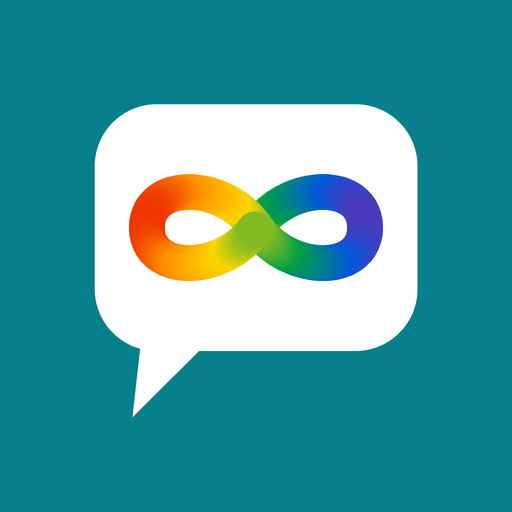
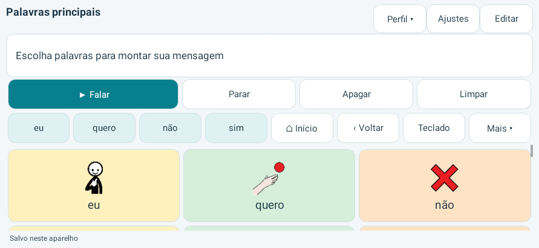

# Voz Livre — Free Voice

**Comunicação Aumentativa e Alternativa (CAA) gratuita e de código aberto para Android.**

[English](README.md) · [Todas as versões](https://github.com/tiagocacote-bot/voz-livre/releases) · [Compilar o código](BUILDING.md)

A comunicação não deveria depender da renda ou da marca de um aparelho. O Voz Livre é um aplicativo gratuito de CAA para Android, criado para ampliar o acesso de pessoas autistas, outras pessoas neurodivergentes e qualquer pessoa que precise de apoio para se comunicar — especialmente famílias que não podem comprar um iPhone ou iPad e só têm aparelhos Android. Oferece um comunicador personalizável para celulares e tablets mais acessíveis. É e sempre será gratuito, sem conta, assinatura ou anúncios.

**A versão 0.3.0 é uma alfa.** A interface está em português, inglês e espanhol; a prancha inicial pode ser criada em qualquer um dos três idiomas. O responsável pelo projeto relata que o uso básico da versão anterior aparentemente funcionou em um Samsung Galaxy S24 FE e em um tablet Samsung SM-P619; a versão do app, as versões do Android e os recursos testados não foram registrados. Ainda precisamos ampliar a avaliação com usuários. É um projeto independente, sem vínculo com a Tobii Dynavox; não é o TD Snap e não oferece todos os recursos dele.

## Como experimentar

1. Toque no botão **Baixar** acima. O link sempre entrega a versão mais recente (`Voz-Livre.apk`).
2. Abra o arquivo em um Android 8.0 ou mais recente e autorize a instalação pelo aplicativo usado para baixar. Quem já tem o Voz Livre instalado atualiza por cima, sem perder os dados.
3. Nas configurações de voz do Android, baixe uma voz em português brasileiro para falar sem Internet. As pranchas e a edição são locais; a fala depende do motor de voz instalado.
4. Revise os símbolos, o vocabulário e os ajustes com a pessoa que vai utilizar. Exporte um backup em **Ajustes** antes de mudanças importantes.

## Recursos desta versão

- 15 páginas iniciais e 317 botões com pictogramas e texto para montar e falar mensagens: **Núcleo** (36 palavras essenciais em posições fixas), **Começar a falar** (inícios de frase por intenção), palavras principais, comida, sentimentos, pessoas, ações, lugares, corpo, frases rápidas, perguntas, escola, brincadeiras, tempo e dias, cores e descrições.
- **Previsão de palavras:** quatro sugestões da próxima palavra, também no teclado. Começa com sugestões em português e aprende, só no aparelho, com as mensagens que cada perfil fala. Pode ser desligada ou apagada em **Ajustes → Tamanho da grade e letras**.
- **Formas das palavras:** toque numa palavra da mensagem para conjugar o verbo (eu brinco, brinquei, brincarei) ou mudar gênero e número (cansado, cansada, cansados). Conjugação automática opcional.
- Edição de páginas, textos, fala, cores, links e visibilidade; fotos próprias pelo seletor do Android.
- Perfis locais separados, busca, teclado, notas, **rotinas visuais com pictogramas**, temporizador e desenho.
- Toque direto, tempo de permanência no toque, seleção ao soltar, pistas auditivas, permanência do ponteiro e varredura automática ou por passos — **também dentro das janelas** (ajustes, edição, teclado, listas), com varredura por grupos quando há muitas opções. Precisam de testes com usuários e equipamentos.
- Backup e restauração em JSON com fotos, desfazer/refazer mensagens e desfazer edição de páginas.
- Importação experimental de `.spb`/`.sps`: textos, links, cores, ordem dos botões, botões ocultos e fotos da própria prancha. Ações sem suporte ficam desativadas para revisão. Símbolos de bibliotecas comerciais (PCS etc.) não são copiados.

## Vocabulário

O vocabulário inicial é original e aberto, baseado em princípios públicos de CAA — vocabulário núcleo, posições fixas para memória motora, organização pragmática e cores por classe de palavra — sem copiar produtos comerciais como PCS, PODD ou Gateway. Detalhes e fontes em [docs/VOCABULARIO.md](docs/VOCABULARIO.md).

## Imagens

Os botões iniciais usam os **pictogramas ARASAAC**, como no protótipo original. Ao atualizar da 0.1.1, os botões iniciais voltam automaticamente para ARASAAC; fotos pessoais e símbolos escolhidos à mão são mantidos. Quem preferir pode voltar para Mulberry e desenhos próprios em **Ajustes → Tamanho da grade e letras → Imagens dos botões iniciais**. Os dois conjuntos ficam disponíveis em **Editar → Escolher símbolo**.

## Limitações atuais

Não inclui calibração ocular, sincronização em nuvem, automação residencial, atividades Boardmaker nem vocabulários comerciais PCS/PODD/Gateway. As formas das palavras e as sugestões conjugadas existem só em português; o símbolo é buscado por palavras em português. Switch Access, acionadores externos, ponteiros e motores de voz precisam de validação em aparelhos reais. Os testes automatizados não demonstram adequação clínica nem segurança para ser o único meio de comunicação de alguém. O vocabulário, as sugestões e os símbolos são um ponto de partida editável.

Tela renderizada em simulação do Android API 35, não em aparelho físico.

## Privacidade e participação

Sem telemetria, anúncios, login ou servidor próprio. O aplicativo não pede permissão de Internet, microfone ou câmera. Os dados — inclusive as palavras aprendidas para as sugestões — ficam no aparelho até você exportar ou compartilhar. O motor de voz e os destinos de compartilhamento possuem políticas próprias. Backups podem conter fotos e mensagens pessoais; guarde-os com cuidado. Veja [PRIVACY.md](PRIVACY.md).

Pessoas que utilizam CAA, autistas, famílias, profissionais de fonoaudiologia, tradutores e desenvolvedores são bem-vindos. Precisamos de testes em aparelhos acessíveis, relatos de barreiras, melhorias de vocabulário e traduções. Veja [CONTRIBUTING.md](CONTRIBUTING.md). Não publique dados pessoais ou backups de famílias nas issues.

## Licenças

- Código, documentação e desenhos próprios: [MIT](LICENSE).
- **Pictogramas ARASAAC**: autor Sergio Palao. Origem: [ARASAAC](https://arasaac.org). Licença: [CC BY-NC-SA 4.0](https://creativecommons.org/licenses/by-nc-sa/4.0/). Propriedade: Governo de Aragão (Espanha). **Uso não comercial.**
- **Mulberry Symbols by Steve Lee**: [CC BY-SA 4.0](https://creativecommons.org/licenses/by-sa/4.0/), incluindo fontes SVG e conversões PNG.
- Consulte [os créditos completos](THIRD_PARTY_NOTICES.md) e a [origem de cada símbolo](app/src/main/assets/symbols-provenance.json).

O Voz Livre é distribuído gratuitamente. Como os pictogramas ARASAAC não permitem uso comercial, o aplicativo com essas imagens não pode ser vendido nem usado em produto comercial; o código MIT pode ser reutilizado separadamente. Não inclui código proprietário do TD Snap, vozes ou símbolos comerciais PCS/PODD/Gateway.
